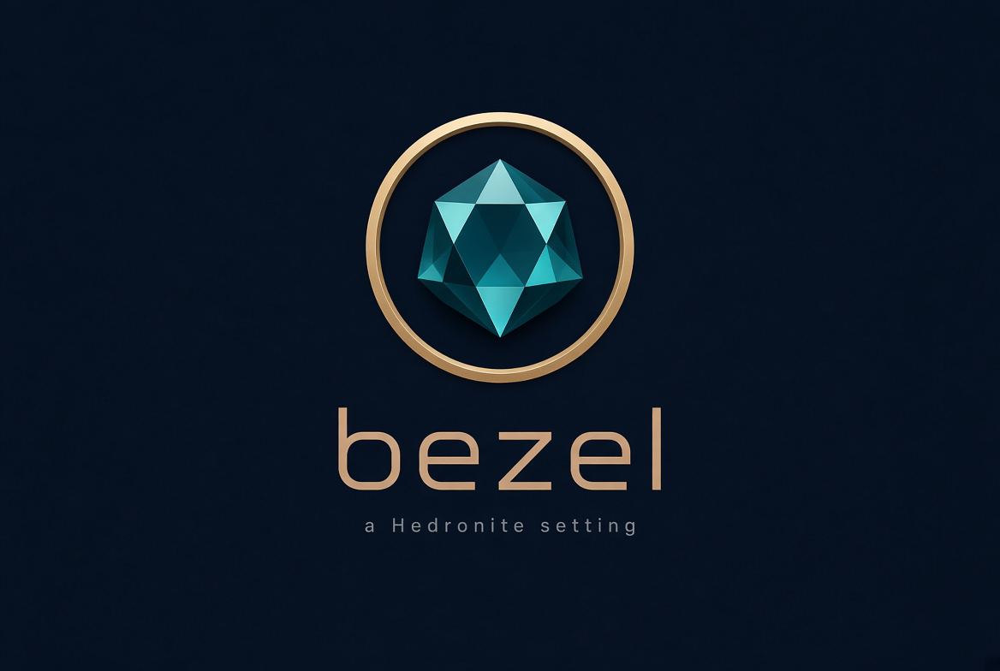

<h1 align="center">Bezel</h1>

<p align="center">
  <a href="docs/brand/">
    
  </a>
</p>

<p align="center">
  A harness overlay: skills, a Jev toolkit, and adapters.<br>
  <strong>a Hedronite setting.</strong><br>
</p>

<p align="center">
  <a href="https://github.com/Hedronite/bezel/actions/workflows/ci.yml"></a>
  <a href="LICENSE"></a>
  <a href="https://nixos.org"></a>
  <a href="https://www.rust-lang.org"></a>
  <a href="https://www.nushell.sh"></a>
</p>

<p align="center">
  <a href="#what-bezel-is">What Bezel is</a> ·
  <a href="#quick-start">Quick start</a> ·
  <a href="#skills">Skills</a> ·
  <a href="#jev">Jev</a> ·
  <a href="#packages-and-names">Packages and names</a> ·
  <a href="#platforms-and-status">Platforms and status</a> ·
  <a href="#contributing">Contributing</a>
</p>

---

Bezel adds skills, a policy gate, and adapters to an agent harness you already run. You keep the harness. This repository holds no harness source.

## What Bezel is

One Nix flake ships four pieces:

| Piece | What you get |
| --- | --- |
| Skills | `.agents/skills/`, the flake's only skills tree (`inputs.skills`). Skills for Lapis (read, plus `reindex`), Facet and Geode (read-only); Phantom's code-graph skill; `tops-verify`, a verify recipe; `goal-pack`, which renders a goal pack from a Nickel intent; and the `check` and `laws` skills. Each skill is a short `SKILL.md` plus a Nushell or Nickel body. |
| Jev | `jev-router`, a Rust binary built from [`crates/bezel-bridle`](crates/bezel-bridle). It prints one JSON verdict per call: loop-stop, a shadow diff check, permission catalogs, a small tool catalog, and typed MCP calls. Shadow is the default, and shadow never blocks. |
| Adapters | `cursor-agent-jev` runs the gate, then execs `cursor-agent`. `grok-build-jev` is the Grok Build PreToolUse adapter. |
| omp wrap, optional | `bezel-omp` runs your `omp` with an overlay that keeps one-line JSON skill replies whole. |

**Live transport is off in this release.** `jev-router` holds exactly one live command, `facet request run --environment typesafe --no-record`, and it is compiled off (`LIVE_ON = false` in `crates/bezel-bridle/src/cli.rs`). Verdicts are computed offline in code, with recorded fixtures standing in for the model. `TYPESAFE_API_KEY` still selects which modes may be honored, but no request leaves the process. No TypeSafe SDK is linked, and there is no Node runtime.

## Quick start

From a clone:

```sh
nix build .#bezel .#jev-router .#cursor-agent-jev .#grok-build-jev
nix run .#jev-router -- --catalog
nix run .#grok-build-jev -- smoke
```

`nix run` also takes `.#bezel` (runs `bezel-omp`) and `.#omapi` (the one-release alias).

`bezel-omp` runs `omp` from `PATH` or `$OMP_BIN`. If neither is present it exits **127** and prints how to fix that. The package attribute is `bezel`; no binary is named `bezel`. The pinned [oh-my-pi v18.2.6](https://github.com/can1357/oh-my-pi/releases/tag/v18.2.6) binary is opt-in, a 180–240 MB download:

```sh
nix build .#bezel-pinned
```

### Flake input and Home Manager

```nix
{
  inputs.bezel.url = "github:Hedronite/bezel";
}

{
  nixpkgs.overlays = [ inputs.bezel.overlays.default ];
  home-manager.users.you = {
    imports = [ inputs.bezel.homeManagerModules.default ];
    programs.bezel.enable = true;
  };
}
```

The older `github:VirtualMachinist/bezel` and `omapi-overlay` URLs follow GitHub's redirect.

| Option | Default | What it does |
| --- | --- | --- |
| `programs.bezel.enable` | `false` | Installs `package` and `extraPackages`, and copies each skill directory into the user skills directories (below). |
| `programs.bezel.package` | `pkgs.bezel` | The omp wrap package. |
| `programs.bezel.extraPackages` | `jev-router`, `cursor-agent-jev`, `grok-build-jev`, `nushell`, `nickel` | More packages on `PATH`. Nushell and Nickel run the skill bodies. |
| `programs.bezel.skillsSource` | `inputs.skills` | The skills tree to copy. Point `inputs.skills.url` at your own skills repo rather than at a second in-repo copy. |
| `programs.bezel.antigravity.enable` | `false` | Registers `~/.agents/skills` in `~/.gemini/config/skills.json` so Antigravity (`agy`) reads the same tree. |

`programs.omapi` is deprecated and renames to `programs.bezel`.

## Skills

The tree in `.agents/skills/` is the source. `scripts/sync-skills` writes regular-file copies to `.claude/skills/`, `.grok/skills/`, and `.cursor/skills/`. Edit the canonical tree, then sync. There is no repo-root `skills/`, `.omp/skills/`, or `.codex/skills/`.

| Skill | What it answers | How it runs |
| --- | --- | --- |
| `lapis` | Vault search (`--mode bm25\|hybrid\|vector`), read (`--section`, `--max-bytes`), links, recent notes, status (`--brief`), and `reindex` of one note in the index | `nu lapis.nu`, over `lapis --json` |
| `facet` | Request history, read-only | `nu facet.nu`, over `facet … --json` |
| `geode` | Custody status, metadata only | `nu geode.nu`, over `geode --output json` |
| `phantom` | Code graph: where a name is defined, callers, impact, call paths, co-change | `nu phantom.nu`, over `phantom-fractal` on `PATH` or `$PHANTOM_FRACTAL_BIN` |
| `tops-verify` | A recipe: what a change reaches (`phantomq diff-impact`), a focused edit, then the TOPS gate (`cargo-tops`, `gotops`, `webtops`) | `SKILL.md` only; each step is its own call |
| `goal-pack` | A multi-role goal pack (hub, REVIEW, SPEC, CHECKLIST, RUBRIC, GOAL, schemas, briefs) from one Nickel intent, judged by contracts before any write | `nu materialize.nu`, over `nickel export`; `law.ncl` holds the contracts |
| `check` | Shadow diff check | `jev-router --check` |
| `laws` | The bridle's laws in Bend (`LAWS.bend`, `PROOF.bend`) | `scripts/bend-gate.sh` runs `bend` on the proof. Bend checks the laws; it is not the hook. |
| `bootstrap` | Placeholder so the input is a valid skills directory | none |

Facet and Geode print one envelope: `{ ok, command, exit, data, error }`. Lapis prints `{ ok, command, data }` (with `meta` when there is more to page or the index lags the disk), or `{ ok: false, command, error: { kind, message, exit } }`. It writes no note: `reindex` writes only the index. Its `SKILL.md` calls it as `lapisq`, an optional shim on `PATH` for `nu lapis.nu` that Bezel does not install. Facet never requests bodies, blobs, `diff --bodies`, or `request run`. Geode refuses every command that is not metadata. `phantom` is a byte copy of Phantom `main`, never edited here, and keeps Phantom's own envelope. Its `index` may run whenever the index is missing or stale; it writes only to Phantom's data directory. For an indexed repository, Phantom's README has a short `AGENTS.md` block that points an agent at the skill, so its first call can be the question without reading `SKILL.md`. `tops-verify` keeps the gate outside `phantom.nu`: Phantom never runs one, and its list of callers and tests never narrows what a gate runs. `goal-pack` layers `law.ncl & org overlay & pack intent`: an upper layer binds `law.list_floor` to its own list, so a later layer can add rules but never drop one. Details for both, and the commit Phantom was copied from, are in [`.agents/skills/README.md`](.agents/skills/README.md).

### Skills first, MCP still shipped

Lapis, Facet, Geode, and Phantom default to skill plus CLI. Their MCP servers (`lapis mcp`, `facet mcp`, `geode mcp`) stay supported, and Bezel does not disable them. A skill costs a few dozen tokens of description until it is used. An MCP server can add every tool's schema to every request, and small local models feel that most. The skill body is fixed code over a versioned JSON contract, so the same input gives the same output. Use MCP when your harness loads tool schemas on demand, or when the client has no shell.

### Install and drift

`programs.bezel.enable` copies each skill directory, as regular files, into `~/.agents/skills`, `~/.claude/skills`, `~/.grok/skills`, and `~/.cursor/skills`. A file whose bytes already match is left alone, mode included. A managed file with different bytes, or a symlink in its place, stops the activation with a drift report and no writes. Repair with `scripts/install-user-skills.sh --force .agents/skills "$HOME"`, or report only with `--check`. Unrelated skill directories stay in place.

### Private-name guard

`scripts/check-private-hashes.sh` keeps an adopter's own host, seat, and path names out of a repository without storing the names. Generate a salted list with `printf '%s\n' name | scripts/check-private-hashes.sh --hash SALT`, then scan with `--hash-file FILE` or `$BEZEL_PRIVATE_HASHES`. A hit exits 1 and prints a `sha256:` prefix, a location, and a redacted path, never the term or the line. A configured but missing or malformed list exits 2. With no list, the guard exits 0: it is opt-in. Short terms also match inside ordinary words, so list them only when that trade is intended.

## Jev

Jev is a shadow-first policy gate. Shadow logs a verdict and does not block.

```sh
JEV_MODE=shadow cursor-agent-jev "<intent>" -- <cursor-agent args>
jev-router --check --intent "<task>"            # or --diff-file FILE
jev-router --catalog
jev-router --schema Bash
```

| Variable | Role |
| --- | --- |
| `JEV_MODE=shadow` | Default. Log the verdict and always run `cursor-agent`. |
| `JEV_MODE=active` | Honor `continue` and `gate: auto` only. `stop` and `escalate` exit 2 and do not exec. `escalate` waits for a person; nothing retries on its own. |
| `JEV_PERMISSION_MODE=active` | Honor the shell, write, and MCP permission catalogs. Needs a key. `JEV_MODE=active` does not turn it on. |
| `JEV_TYPED_CALL_MODE=active` | Honor ranked MCP typed calls. Needs a key. Until set, MCP stays ask. |
| `JEV_BYPASS=1` or `true` | Skip the router. Other values (`yes`, `false`, `0`) are not a bypass. |
| `JEV_ROUTER` | Override the router binary used by the wrap. |
| `JEV_STEP_DIGEST` | Optional step digest for loop-stop. |
| `TYPESAFE_API_KEY` | Runtime only; the flake never stores it. With no key, shadow continues unclassified and active stops. |

What each surface does, in brief:

- **Loop-stop** labels a step `continue`, `stop`, or `escalate`. Thresholds are in `omapi-loop-stop-policy@1` (`conf ≥ 0.6`, `p ≥ 0.55`, `margin ≥ 0.15`). [docs/SPIKE-loop-stop.md](docs/SPIKE-loop-stop.md)
- **Shadow check** reads a git diff and reports `findings`, `parked`, and `notChecked`. Empty findings are **not** approval. [docs/SPIKE-stanley.md](docs/SPIKE-stanley.md)
- **Permission catalogs** map shell, write, and MCP calls: `allow` → continue, `deny` → stop, `ask` → escalate. [docs/SPIKE-permission.md](docs/SPIKE-permission.md)
- **Tool catalog.** Every verdict carries a small index (`catalog.kind = tiny`) of class, policy id, and tool names. `--schema NAME` prints one schema. A schema dump is `decision: defer`, never an allow, and an unmapped name denies with exit 2. [docs/SPIKE-catalog.md](docs/SPIKE-catalog.md)
- **Typed calls** rank an MCP intent into a `tool_call` payload. The router does not invoke the tool. [docs/SPIKE-calls.md](docs/SPIKE-calls.md)
- **Grok Build.** `grok-build-jev hook` reads a PreToolUse event and prints `defer` or `deny`, never `allow`. `config` prints a hook document for review; Bezel installs no host hook. [docs/GROK-BUILD.md](docs/GROK-BUILD.md)

The policy ids and the PreToolUse matcher are in [docs/POLICY-MAP.md](docs/POLICY-MAP.md). The source of truth is `crates/bezel-bridle/src/policy.rs`, and a crate test fails if the two drift.

## Packages and names

| Package | What it is |
| --- | --- |
| **`bezel`** (default) | `bin/bezel-omp`, the omp wrap. Also `bin/omapi` (a one-release symlink), `share/bezel/omp-overlay.yml`, and `libexec/bezel-planes-shim`. |
| **`bezel-pinned`** | The same wrap, pointed at the fetched oh-my-pi v18.2.6 binary. |
| **`jev-router`** | `bin/bezel-bridle` and `bin/jev-router`, which execs it. Rust; the build runs the crate tests. |
| **`cursor-agent-jev`** | Runs `jev-router`, then execs `cursor-agent`, which must already be on `PATH`. `--catalog` and `--schema` print and do not exec. |
| **`grok-build-jev`** | Execs `jev-router` with the Grok Build subcommands (`hook`, `config`, `smoke`, `catalog`). |
| **`nushell`**, **`nickel`** | The interpreters for the skill bodies, from the nixpkgs pin in `flake.lock`. |

**The omp overlay.** By default omp cuts each tool-output line at 768 bytes, which truncates a skill's one-line JSON reply. `share/bezel/omp-overlay.yml` sets `tools.outputMaxColumns: 8192` and nothing else. `bezel-omp` passes it as `--config` ahead of your arguments, so a `--config` of your own still wins. `BEZEL_OMP_OVERLAY=0` passes no overlay.

**The planes shim.** With `BEZEL_PLANES=1`, `bezel-omp` runs `libexec/bezel-planes-shim` before exec. If `BEZEL_PLANES_VERDICT` names a file whose `gate=` line is `hold`, or names a path that is not a file, the shim exits 2 and omp does not start.

| What | Name |
| --- | --- |
| Product, flake input, package | Bezel, `bezel`, `bezel-pinned` |
| Binaries | `bezel-omp`, `jev-router`, `bezel-bridle`, `cursor-agent-jev`, `grok-build-jev` |
| One-release aliases | `omapi` → `bezel-omp`; `.#omapi` is `bezel`, `.#omapi-pinned` is `bezel-pinned` |
| Home Manager | `programs.bezel` (`programs.omapi` renames to it) |
| Env | `BEZEL_*`. Legacy `OMAPI_*` is still read, except `BEZEL_OMP_OVERLAY`, which has no alias. |
| Frozen ids | Policy ids `omapi-loop-stop-policy@1`, `omapi-check-policy@1`, `omapi-route-workflow-policy@1`, and the typed-call host profile `omapi-jev-router`. Changing them would change verdicts, so they keep the old prefix. |

The Rust crate is published as [`bezel-bridle`](https://crates.io/crates/bezel-bridle). It is not the crates.io crate `bezel`, which is an unrelated gpui component library.

## Platforms and status

Declared systems: `aarch64-darwin`, `aarch64-linux`, `x86_64-linux`. Intel macOS is not supported; nixpkgs dropped it.

| System | Pinned omp binary | CI |
| --- | --- | --- |
| `x86_64-linux` | `omp-linux-x64` | Runs: `nix flake check` and the package builds. |
| `aarch64-linux` | `omp-linux-arm64` | Skipped with a stated reason (no hosted runner). |
| `aarch64-darwin` | `omp-darwin-arm64` | Skipped with a stated reason (no hosted runner). |

If a later oh-my-pi release drops a platform, `packages/omp-pin.nix` throws for that system rather than pretending. `nix flake check` and the four package builds do not download the pin; only `.#bezel-pinned` does.

- `jev-router` is the Rust `bezel-bridle` 0.2.1 binary. The JavaScript prototype it replaced has been removed.
- Live transport is off. Every Jev surface defaults to shadow.
- Skills ship from one tree and install as regular files. MCP stays supported.
- Bend checks the laws in `.agents/skills/laws`; it does not run the hook.

## Contributing

Issues and pull requests are welcome. Match CI from a clone:

```sh
nix flake check -L
nix build -L .#bezel .#jev-router .#cursor-agent-jev .#grok-build-jev
cargo test --manifest-path crates/bezel-bridle/Cargo.toml
```

`nix flake check` runs `bezel-hm-eval`, `bezel-wrap-contract`, `bezel-launch-quiet`, `jev-bypass`, `jev-router-unit`, `jev-check-shadow`, `jev-loop-stop-wrap`, `jev-tool-catalog`, `grok-build-harness`, and `skills-cli`. The last one runs `scripts/check-skill-copies.sh`, `check-user-skills.sh`, and `check-skill-cli.sh`.

- Edit skills in `.agents/skills/`, then run `scripts/sync-skills`. CI fails if the harness copies drift.
- Agent-facing rules are in [AGENTS.md](AGENTS.md).
- Do not commit secrets. `TYPESAFE_API_KEY` and other keys belong in the process environment, and CI scans for baked keys.

## License

[MIT](LICENSE). Built by [VirtualMachinist](https://github.com/VirtualMachinist). A [Hedronite](https://hedronite.com) setting. The lockup is in [docs/brand/](docs/brand/).

`bezel-pinned` downloads published binaries from [oh-my-pi](https://github.com/can1357/oh-my-pi/releases/tag/v18.2.6) v18.2.6. This repository does not include that project's source. Install a host `omp` from [omp.sh](https://omp.sh), or set `OMP_BIN`.

Bezel is not Omarchy.
